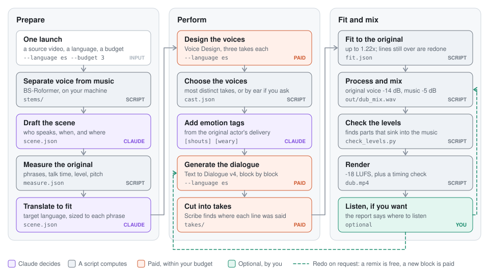

# anime-redub

Fully automatic voice-over dubbing for anime and other video, in the language you choose. One launch ends in a finished video: every character gets their own AI voice, each line starts where the original phrase starts, and the original stays quietly underneath. It runs on ElevenLabs Text to Dialogue v4 and Scribe. Claude Code handles the translation, tags and decisions through a ready-made skill, and scripts do everything that can be computed.

<picture>
  <source media="(prefers-color-scheme: dark)" srcset="docs/pipeline-dark.svg">
  
</picture>

## How to use it

Open Claude Code in a separate working folder and write something like this:

> Dub the scene from 7:05 to 9:45 of `~/Video/show_01.mkv` into Spanish, with a budget of 3 dollars.

Or launch the skill with flags:

```
/anime-redub:anime-redub --language es --budget 3 ~/Video/show_01.mkv 7:05-9:45
```

| What | Flag | Default |
|---|---|---|
| Source file | a path | required |
| Window | `7:05-9:45` | the whole file, from the first spoken line to the last |
| Target language | `--language es` | required |
| Spending limit | `--budget 3` | 5 US dollars |
| Choose voices by ear | `--pick-by-ear` | off: chosen automatically |

**It spends money without asking, up to the limit.** The paid scripts enforce the limit themselves, counting each request before it is sent. It works from estimates at the documented prices, not from your account's balance. If you would rather approve each payment, or go 15 seconds at a time, say so when you launch.

To run with nobody at the keyboard, use print mode:

```bash
claude -p "Dub the scene from 7:05 to 9:45 of ~/Video/show_01.mkv into Spanish, with a budget of 3 dollars." --allowedTools "Bash,Read,Write,Edit"
```

Claude then goes through the steps in [SKILL.md](skills/anime-redub/SKILL.md) on its own:

1. Separates voice from music, in chunks that can resume.
2. Finds the real phrases in the original, with their length, loudness and pitch.
3. Translates to the length of those phrases.
4. Makes voices with Voice Design, and keeps the previews most unlike each other. With `--pick-by-ear`, it stops once so you can choose on an audition page.
5. Adds emotion tags that follow the original performance.
6. Generates the scene in blocks, one request per block, so the voices do not drift.
7. Fits the takes to the original phrase onsets, speeding up by at most 1.22 times, and redoes lines that still run over, at most twice per block.
8. Mixes with the original voice at −14 dB and the music at −5 dB.
9. Checks the levels, renders the video and reports what it spent, what it chose and where a person should listen.

The scripts also run without Claude, but then the translation, the tags and the choice of what to redo are yours. Commands and formats are in [SKILL.md](skills/anime-redub/SKILL.md) and [formats.md](skills/anime-redub/references/formats.md).

## What has actually been tested

**One 2:40 scene was dubbed from Japanese into Russian with real voices and judged by ear**, by one listener. Those steps were run by hand, and voices were chosen by ear.

**The automatic run has gone through the real API once**, on a 14-second scene from Japanese into English. One launch produced the video, for about 6 cents by the budget's estimate. Scribe then found every word in the final mix, with each line starting within 0.1 s of the original phrase. Its one listener liked how it sounded. That is a good first sign from 14 seconds and two characters, not proof for a whole scene. Choosing voices by numbers could not replace listening when it was tried on the Russian scene, so expect to want `--pick-by-ear` sometimes.

The spending limit has only been reached against a local stand-in for the ElevenLabs API, which returns tones instead of speech. Voice Design reported no cost in that one real run, so its share of the estimate is unconfirmed.

The print-mode command above has not completed a run: its one attempt stopped at login. The automatic runs were Claude Code sessions that were allowed more tools than that command lists, so try that command on something short first.

Target languages other than Russian and English are covered by the same stand-in and by automated tests, so start with something short. Any other source language should work, since only Scribe reads it, but only Japanese has been run. A whole episode has not been dubbed, so it may show problems that one scene did not. The automated tests check the code, not the sound.

## Choosing the language

The target language is a parameter of each run, given as a code such as `es`, `de`, `fr`, `ja`, `ko`, `zh`, `pt` or `ru`. To see all of the 90+ codes:

```bash
python skills/anime-redub/scripts/languages.py
```

| Script | `--language` |
|---|---|
| `design_voices.py` | Required. The language the voices will speak. |
| `dialogue.py` | Required. The language of the lines. |
| `scribe.py` | Optional. The language of the audio. Left out, Scribe detects it. |

`design_voices.py` and `dialogue.py` have no default and refuse an unknown code before any paid call. The ElevenLabs reference says a code the model does not support is ignored, and this repository has not tested that. `scribe.py` sends its code as given. Nothing checks that your lines and voices are really in that language, so pass the same code to both.

## What it costs

| What | Price |
|---|---|
| A 2:40 scene, one pass | about $0.17 |
| An episode, one clean pass | about $1.50 |
| An episode with redos | $2–3 |
| Voice Design | about a cent per story character tried, by calculation |
| Separating voice from music | free, about 2 hours per episode on a laptop |

Prices come from the ElevenLabs documentation as of November 2026: $0.08 per 1,000 characters of text and $0.22 per hour of Scribe. The figures were worked out on the Russian scene, and another language will have a different number of characters. The episode is that scene multiplied by 8 by volume of text, and no episode was actually generated. Tags are billed as ordinary characters and made up about half of the bill. Translation and tags use your Claude subscription, which is not counted here.

## Install

```bash
brew install ffmpeg rubberband        # Linux: apt install ffmpeg rubberband-cli
git clone https://github.com/totruok/anime-redub.git
cd anime-redub
python3 -m venv .venv && source .venv/bin/activate
pip install -r requirements.txt
pip install -r requirements-separate.txt    # a big install, needed for separate.py
export ELEVENLABS_API_KEY=...         # or a .env file in the working folder
python skills/anime-redub/scripts/doctor.py
```

The skill for Claude Code installs as a plugin. Its scripts need the same dependencies, so start Claude Code from the activated environment.

```
/plugin marketplace add totruok/anime-redub
/plugin install anime-redub@anime-redub
```

## Why the balance is what it is

Dubs keep the original at very different levels, and there is no single standard. The −14 dB voice and −5 dB music were measured from one modern dub and adjusted to our voice level. The measurements, and how to take them from any other dub, are in [mix-recipes.md](skills/anime-redub/references/mix-recipes.md).

## Rights

This repository holds code and method only. Video, audio, subtitles and dubs stay out of it, and `tests/test_repo_hygiene.py` checks that. Anime belongs to its rights holders: the result is for personal viewing, and publishing it is your own responsibility. Voices are created with Voice Design. This project does not offer cloning of real people, the original actors included.

## Tests

```bash
pip install -r requirements-dev.txt
pytest
```

The tests use synthetic sound and no outside network, so they make no paid requests. One runs the whole pipeline against `tests/fake_elevenlabs.py`, a local stand-in for the API. They need ffmpeg and rubberband.

## License

MIT
